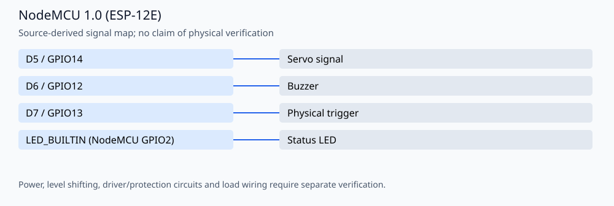

# KabelMarker Pro — ESP8266 servo marker

An ESP8266 access-point controller with an embedded web button, a physical trigger and a servo marking cycle. Design and code: **Amir Mobasheraghdam**. The committed source is named **`c++`**, not `KabelMarker_Pro.ino`.

## Reproducible build

Install Python 3 and **Arduino CLI 1.3.1**, then run from this repository:

```bash
python3 tools/check_firmware.py --install
```

The helper installs `esp8266:esp8266@3.1.2` and the libraries bundled with the core. It compiles these alternatives
separately in temporary folders, without uploading or rewriting the originals:

- `c++`

Build target: `esp8266:esp8266:nodemcuv2`. Once dependencies are installed, omit `--install`
to build offline. `--jobs 2` is the default. Set `ARDUINO_CLI` to a CLI executable
or wrapper when using a custom Arduino configuration. Exact build inputs are in
[`tools/firmware.json`](tools/firmware.json). Library dependencies are listed
explicitly and installed with `--no-deps` so transitive updates cannot silently
replace the pinned versions. These are tested build versions, not a claim that
all other core/library versions are incompatible.

The GitHub Actions workflow repeats the firmware checks on pushes and pull
requests. Compilation validates software/toolchain compatibility; it does not
establish hardware safety or successful physical operation.

## Signal assignments



| Signal | Board pin |
| --- | --- |
| Servo signal | D5 / GPIO14 |
| Buzzer | D6 / GPIO12 |
| Physical trigger | D7 / GPIO13 |
| Status LED | LED_BUILTIN (NodeMCU GPIO2) |

## Operation and validation limits

The trigger is a normally open contact to GND using `INPUT_PULLUP` and a falling-edge interrupt. Board aliases shown are for the selected NodeMCU build target; check other boards separately. The servo requires a correctly rated supply and signal interface. A GPIO is not a motor power source.

For Arduino IDE, copy `c++` to `KabelMarker_Pro/KabelMarker_Pro.ino`. WiFi, WebServer and Servo come with the ESP8266 core. The complete HTML is embedded in the source: **there is no `data/` directory and no LittleFS upload is required**.

Connect to the open **KabelMarker_Pro** AP and use the IP printed at **115200 baud** (normally http://192.168.4.1/). The existing GET `/move` endpoint can move the servo; the controller has no authentication. Use only in a controlled local environment. The source defaults to 20°→110°→20°, a 140 ms hold and 6 ms stepping; `DEFAULT_SPEED` does not control stepping. No angle, trigger or movement behavior is changed here. Repeated web/physical triggers and mechanical travel require bench verification before attachment to a mechanism.

No physical testing, new hardware photographs or measured electrical/optical
performance is claimed. Retain the author attribution and existing license/source
notices when reusing the project.
